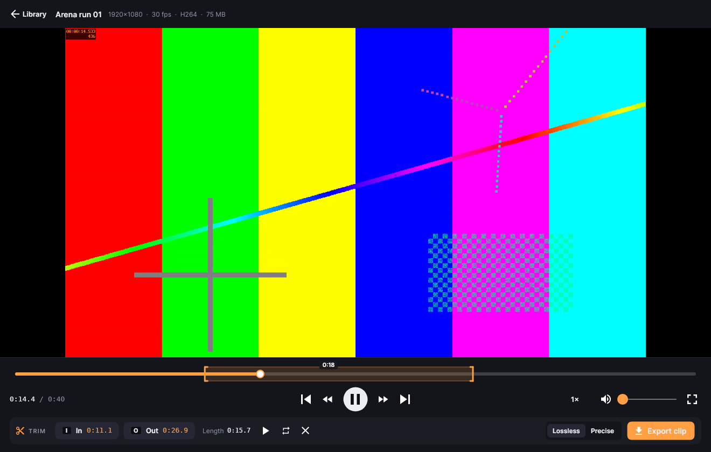

# Cinema

A video library and player built on libVLC. Point it at folders, it scans them for videos, and you can
play anything VLC can play and cut clips out of it without leaving the app.




Stack: C# / .NET 8, [Avalonia 11](https://avaloniaui.net) for UI, [LibVLCSharp](https://code.videolan.org/videolan/LibVLCSharp)
for playback, ffmpeg/ffprobe for thumbnails, metadata and clip export. One codebase for macOS, Windows and Linux.

## Download

Grab a build from [Releases](https://github.com/TheRoben-Dev/Cnema/releases). They are self-contained, so .NET is
not needed, but you still need VLC (macOS/Linux) and ffmpeg.

The macOS app is not notarized, so the first launch needs either right-click → Open, or:

```sh
xattr -dr com.apple.quarantine /Applications/Cinema.app
```

## Run from source (macOS)

```sh
brew install --cask dotnet-sdk vlc     # .NET 8+ SDK and VLC.app (provides libVLC)
brew install ffmpeg                    # thumbnails + clip export
dotnet run --project src/Cinema
```

Build a real `Cinema.app` with the icon: `scripts/bundle-macos.sh` (output in `dist/`).

Releases are built by GitHub Actions: run the **Release** workflow with a version number (or push a tag like
`v0.2.0`) to publish macOS (Apple Silicon and Intel), Windows and Linux builds.

| OS | libVLC comes from | Notes |
| --- | --- | --- |
| macOS | `/Applications/VLC.app` (or `~/Applications`) | Must match your CPU arch; the universal/arm64 VLC build on Apple Silicon. |
| Windows | `VideoLAN.LibVLC.Windows` NuGet (bundled automatically) | `winget install ffmpeg` |
| Linux | system packages: `sudo apt install libvlc5 vlc-plugin-base ffmpeg` | |

Set `CINEMA_LIBVLC_PATH` to a folder containing libvlc + libvlccore to override.

## Features

- **Library**: add any number of folders; scanned recursively, watched for changes, cached so launch is instant.
  Thumbnails, duration, resolution, codec, size. Search, sort, per-folder filtering, resume position.
- **Player**: libVLC playback, frame stepping, speed, volume, fullscreen.
- **Trim**: set in/out at the playhead or drag the brackets on the timeline, preview/loop the selection, export.
  - *Lossless* (default): stream copy. Instant, zero quality loss, keeps the container. The cut starts on the
    keyframe at or before the in point, so the clip can start up to a GOP earlier than marked.
  - *Precise*: re-encodes to H.264/AAC MP4 (CRF 18). Frame-accurate, slower, slight generation loss.

### Shortcuts (player)

| Key | Action | Key | Action |
| --- | --- | --- | --- |
| Space / K | Play / pause | I / O | Set in / out |
| ← / → | Seek 5 s (Shift: 1 s) | Shift+I / Shift+O | Jump to in / out |
| J | Back 10 s | P | Play selection |
| , / . | Previous / next frame | L | Loop selection |
| ↑ / ↓ | Volume | X | Clear selection |
| M | Mute | E | Export clip |
| F | Fullscreen | Esc | Back to library |

## Layout

```
src/Cinema
  Services/    VlcBootstrap (native lib loading per OS), LibraryService (scan/cache/watch),
               MediaProbe, ThumbnailService, TrimService, ToolLocator, PlatformShell, AppPaths
  Controls/    VideoFrameBuffer + VideoSurface (libVLC -> bitmap), TrimTimeline (scrubber with in/out)
  ViewModels/  MainViewModel (library), PlayerViewModel (transport + trimming)
  Views/       MainWindow
```

Data lives in `~/Library/Application Support/Cinema` (macOS), `%LOCALAPPDATA%\Cinema` (Windows),
`~/.local/share/Cinema` (Linux).

## Design notes

- **Not a fork of VLC's source.** VLC itself is ~1M lines of C/C++/Obj-C with a separate UI per platform;
  libVLC is the same engine exposed as a library, so playback is identical while the UI is ours.
- **Video is rendered through libVLC's frame callbacks** into an Avalonia bitmap rather than handing VLC a
  native window. It behaves the same on every OS and lets UI sit on top of the video. The cost is one CPU copy
  per frame (and no zero-copy GPU path); fine through 4K, worth revisiting for 8K/high-fps HDR.
- **All OS-specific code is in four places**: `VlcBootstrap`, `AppPaths`, `PlatformShell`, `ToolLocator`,
  plus title-bar insets in `MainWindow.axaml.cs`.

## Licensing

Cinema is MIT licensed. libVLC is LGPL-2.1+ (dynamically linked). ffmpeg is invoked as an external process.
