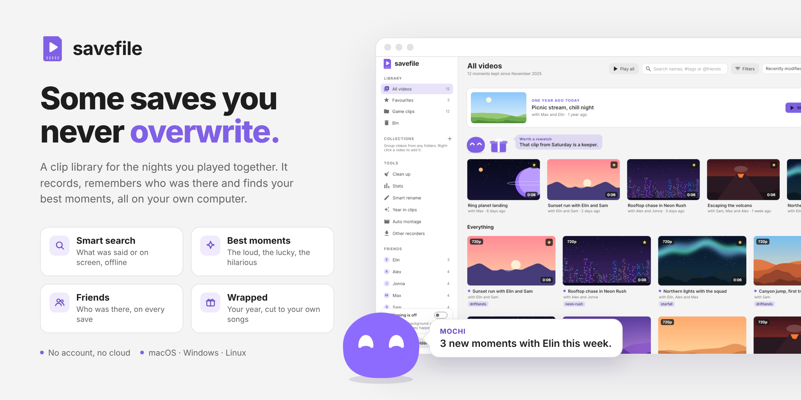
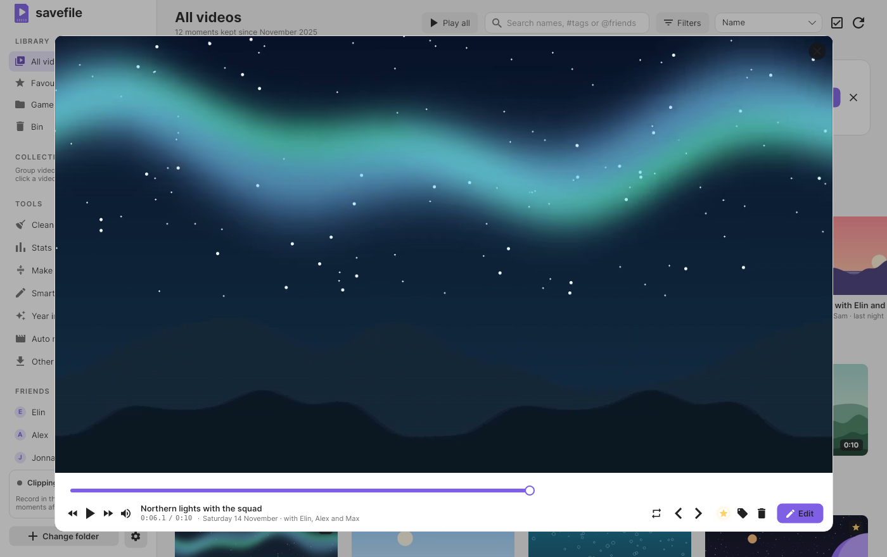
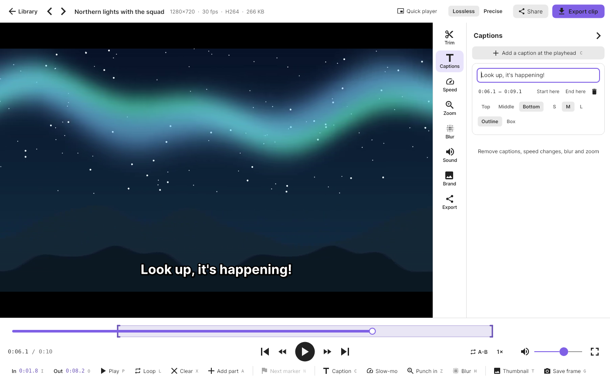
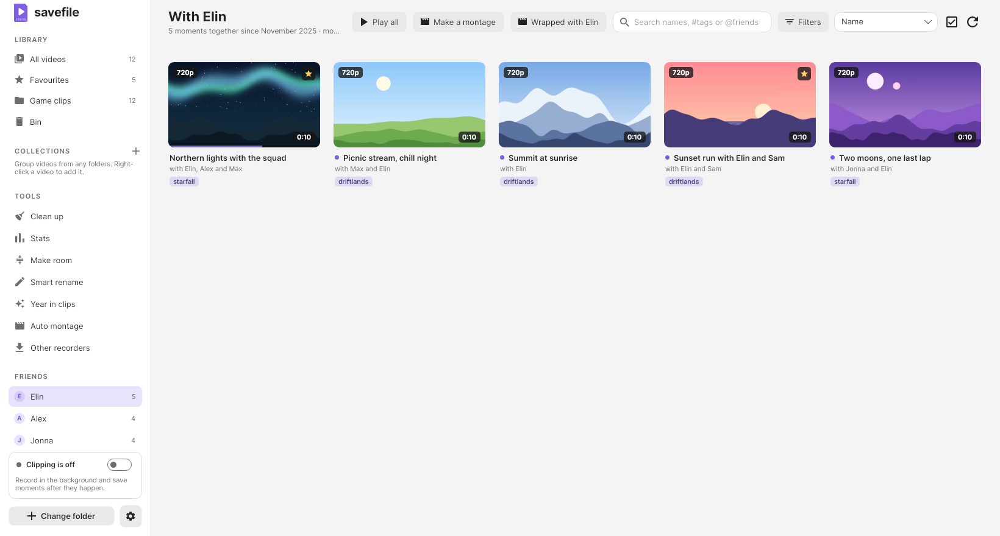
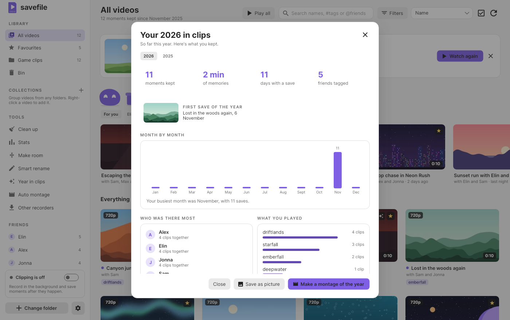

# Savefile

*Some saves you never overwrite.*

The late nights, the lost runs, the one clutch nobody believes. Savefile quietly records while you play,
keeps the moments you shared with your friends in a library on your own machine, and makes them easy to trim,
caption and send to the group chat. No account, no cloud. Built on the VLC engine.

Savefile was called **Cnema** up to v0.22. The repository, the release mirror and the app file
(`Cnema.app`, `Cnema.exe`) keep the old name for now so existing installs keep updating themselves.

<picture>
  <source media="(prefers-color-scheme: dark)" srcset="docs/savefile-hero-dark.png">
  
</picture>

## Download

Get the latest build from **[Savefile releases](https://github.com/TheRoben-Dev/Cnema-releases/releases/latest)**
(macOS Apple Silicon and Intel, Windows, Linux). Everything is bundled: the .NET runtime, libVLC and ffmpeg.
Savefile updates itself after that.

**First launch:** the builds aren't signed.

- **macOS:** right-click Cnema.app and choose **Open** (or run `xattr -dr com.apple.quarantine /Applications/Cnema.app`).
- **Windows:** run `Savefile-…-windows-x64-setup.exe` and choose to install for just you (no administrator needed) or for everyone on the PC (Program Files). It adds Start menu and desktop shortcuts and an entry in Apps to uninstall it. The setup isn't signed, so if SmartScreen shows "Windows protected your PC", click **More info**, then **Run anyway**. The `windows-x64.zip` is the portable version: unzip it anywhere (a USB stick works) and run `Cnema.exe`.
- **Linux:** install libVLC from your distro first, e.g. `sudo apt install libvlc5 vlc-plugin-base`.

## Features

- **Memories:** a "Worth a rewatch" row of old favourites and clips with friends, an "On this day" card,
  "Who was there" tags that search finds with `@name` (with a Friends list in the sidebar and "Playing with"
  to tag everyone on every save), Year in clips (a look back on a year, with a montage of it and a picture to share), Savefile Wrapped (a 5–10 minute video of your year cut to the beat of your own songs, with animated chapters about your games, your people and your best laughs, plus a shorter cut with any friend; Mochi hands it over as a present in November and December), Play all (a
  slideshow of any view in the Quick player), and small
  milestones as your saves add up. Mochi, Savefile's blob mascot, presents Worth a rewatch with a line about your clips, reacts to your saves, dresses up for December and helps out with backups and problems (every behaviour can be switched off).
- **Library:** one library folder (or several, if you like), merging scattered folders into one, thumbnails with hover scrub, search (names, `#tags`, `@friends`, years, months),
  filters, tags, favourites, collections, bulk select, duplicate finder and stats.
- **Backup to your own server:** favourites or every video, with their tags, friends and notes, to a folder
  on any computer you can SSH into (SFTP, key or password) or to an S3-compatible server (Garage, SeaweedFS,
  MinIO), and restore on a new computer. Off by default; nothing leaves your network.
- **Smart, on your computer:** best moments found by sound and picture (a sparkle on the ones that stand out,
  and they lead Worth a rewatch, montages and Year in clips), smart titles from game, friends and date, and
  Smart rename for the whole library, thumbnails from a lively frame and trim suggestions for dead air at the
  start or end. No account, no cloud, nothing downloaded. Every smart setting says what it
  costs (CPU, memory, download, time for your library) before you switch it on.
- **Voice search and captions:** what's said in your videos is written down on your computer, so you can
  search for it, watch with captions, and turn it into captions for an export (optional 57 MB speech model).
- **Visual search and similar videos:** search for what's on screen ("snow", "a car"), see Videos like this one,
  and let Clean up spot copies saved twice (optional 169 MB visual model; runs on your computer).
- **Laughter and hype:** the videos where everyone lost it come first in Worth a rewatch, and search finds
  "laughing" or "hype" (optional 15 MB sound model).
- **Text on screen:** reads kill feeds, scoreboards and banners, so search finds a name from the kill feed, titles say
  "Victory Royale" or "Ace", and a clip with no game gets one when the HUD gives it away (optional 10 MB text reader).
- **Friend picks:** pick a friend above Worth a rewatch for the best of your clips together, presented by Mochi.
- **Who's talking:** tells your friends' voices apart and fills in Who was there. Mochi learns the voices in
  "Who's that?", a short listening game (optional 26 MB voice model; needs Voice search).
- **Quick player:** videos open in a large player shaped to the video, with a gold favourite star that glimmers (F); **Edit** takes you to the full editor.
- **Editor:** a tool rail with Trim, Captions, Speed, Sound, Brand and Export. Lossless or frame-accurate trims,
  multi-part export, captions, slow-mo with ramps, loudness and voice tools (including noise removal), watermark and intro/outro,
  and a background export queue. Optionally remembers your edits per video until you start over.
- **Share:** one-click presets for Discord (10 / 50 MB), vertical 9:16 (smart crop follows the action) and GIF.
- **Clipping:** a rolling replay buffer with GPU encoding (H.264, HEVC, AV1). Several hotkeys with their own
  clip lengths, webcam overlay, session recording with bookmarks, separate game and mic tracks,
  per-game profiles and storage limits.
- **Make it yours:** everything optional can be switched off under **Settings, Features**. Dark and light mode,
  rebindable shortcuts (press **?**), accessibility options, portable mode and settings backup.
- **Languages:** English and Swedish, following the system language by default. Translations are flat JSON
  files in `src/Cnema/Assets/Lang/` (`"English": "translation"`); `scripts/check-translations.py` lists gaps.

See [CHANGELOG.md](CHANGELOG.md) for what's new in each version.

## A look around

**Quick player:** videos open over the library, with who was there and a gold favourite star.

<picture>
  <source media="(prefers-color-scheme: dark)" srcset="docs/screens/quick-player-dark.png">
  
</picture>

**Editor:** trim, captions, speed, zoom, blur, sound, branding and export, one tool rail.

<picture>
  <source media="(prefers-color-scheme: dark)" srcset="docs/screens/editor-dark.png">
  
</picture>

**Share:** one click to fit Discord, go vertical for Shorts and TikTok, or make a GIF.

<picture>
  <source media="(prefers-color-scheme: dark)" srcset="docs/screens/share-dark.png">
  
</picture>

**Friends:** every clip with someone, a montage of your best moments together and a Wrapped of just the two of you.

<picture>
  <source media="(prefers-color-scheme: dark)" srcset="docs/screens/friend-dark.png">
  
</picture>

**Year in clips:** a look back at the year, with a montage and a picture to share.

<picture>
  <source media="(prefers-color-scheme: dark)" srcset="docs/screens/recap-dark.png">
  
</picture>

## Build from source

Needs the .NET 8+ SDK and ffmpeg on your PATH. libVLC comes from NuGet on macOS and Windows.

```sh
dotnet run --project src/Cnema
```

`scripts/bundle-macos.sh` builds a real `Cnema.app` in `dist/`. Releases are built by the **Release**
GitHub Actions workflow.

## License

MIT. Release builds bundle libVLC (LGPL) and ffmpeg (GPL); see [THIRD-PARTY-NOTICES.md](THIRD-PARTY-NOTICES.md).
