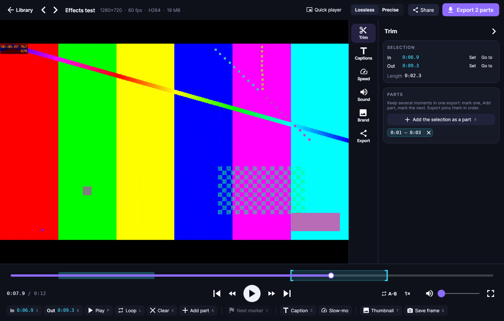
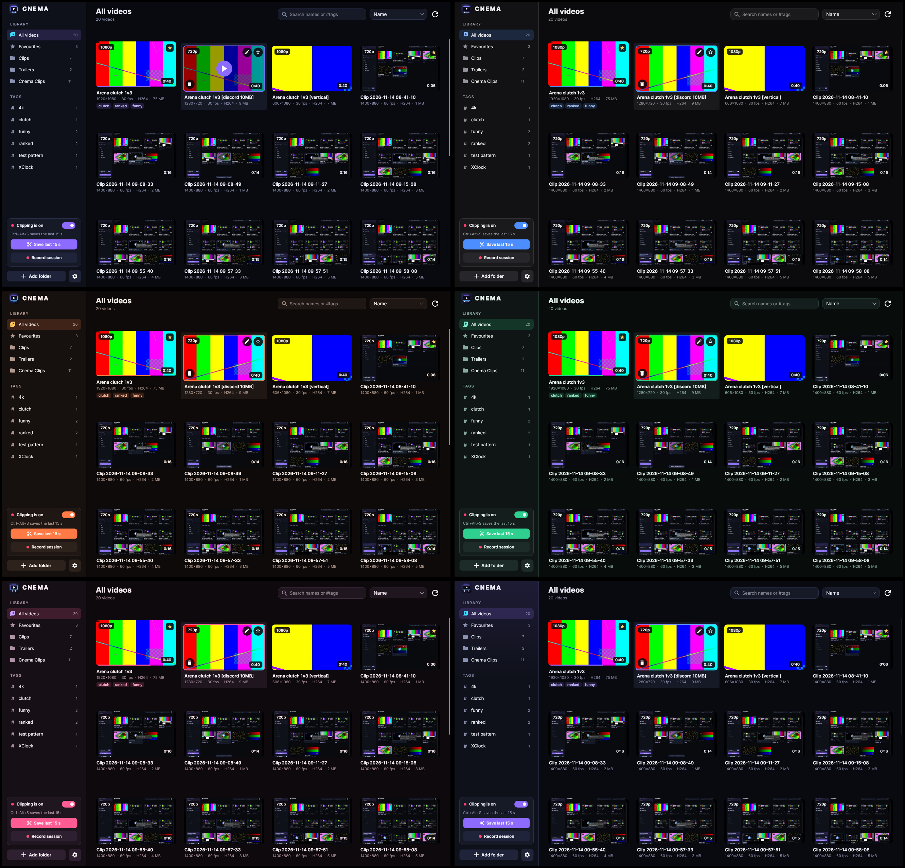

# Cnema

A clip library, player, editor and clipper for game footage, built on the VLC engine. Point it at your folders,
watch anything VLC can play, cut and share clips, and save the last few seconds of gameplay with a hotkey.



## Download

Get the latest build from **[Cnema releases](https://github.com/TheRoben-Dev/Cnema-releases/releases/latest)**
(macOS Apple Silicon and Intel, Windows, Linux). Everything is bundled: the .NET runtime, libVLC and ffmpeg.
Cnema updates itself after that.

**First launch:** the builds aren't signed.

- **macOS:** right-click Cnema.app and choose **Open** (or run `xattr -dr com.apple.quarantine /Applications/Cnema.app`).
- **Windows:** if SmartScreen shows "Windows protected your PC", click **More info**, then **Run anyway**.
- **Linux:** install libVLC from your distro first, e.g. `sudo apt install libvlc5 vlc-plugin-base`.

## Features

- **Library:** watched folders, thumbnails with hover scrub, search, filters, tags, favourites, collections,
  bulk select, duplicate finder and stats.
- **Quick player:** videos open in a large player over the library; **Edit** takes you to the full editor.
- **Editor:** a tool rail with Trim, Captions, Speed, Sound, Brand and Export. Lossless or frame-accurate trims,
  multi-part export, captions, slow-mo with ramps, loudness and voice tools, watermark and intro/outro,
  and a background export queue. Optionally remembers your edits per video until you start over.
- **Share:** one-click presets for Discord (10 / 50 MB), vertical 9:16 and GIF.
- **Clipping:** a rolling replay buffer with GPU encoding (H.264, HEVC, AV1). Several hotkeys with their own
  clip lengths, webcam overlay, session recording with bookmarks, separate game and mic tracks,
  per-game profiles and storage limits.
- **Make it yours:** everything optional can be switched off under **Settings, Features**. Color schemes,
  rebindable shortcuts (press **?**), accessibility options, controller mode, portable mode and settings backup.
- **Languages:** English and Swedish, following the system language by default. Translations are flat JSON
  files in `src/Cnema/Assets/Lang/` (`"English": "translation"`); `scripts/check-translations.py` lists gaps.

See [CHANGELOG.md](CHANGELOG.md) for what's new in each version.



## Build from source

Needs the .NET 8+ SDK and ffmpeg on your PATH. libVLC comes from NuGet on macOS and Windows.

```sh
dotnet run --project src/Cnema
```

`scripts/bundle-macos.sh` builds a real `Cnema.app` in `dist/`. Releases are built by the **Release**
GitHub Actions workflow.

## License

MIT. Release builds bundle libVLC (LGPL) and ffmpeg (GPL); see [THIRD-PARTY-NOTICES.md](THIRD-PARTY-NOTICES.md).
