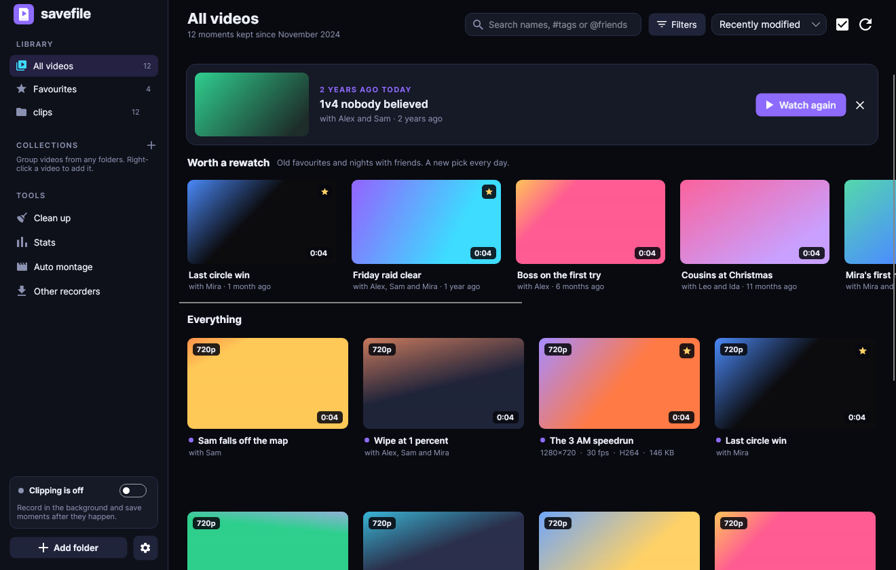

# Savefile

*Some saves you never overwrite.*

The late nights, the lost runs, the one clutch nobody believes. Savefile quietly records while you play,
keeps the moments you shared with your friends in a library on your own machine, and makes them easy to trim,
caption and send to the group chat. No account, no cloud. Built on the VLC engine.

Savefile was called **Cnema** up to v0.22. The repository, the release mirror and the app file
(`Cnema.app`, `Cnema.exe`) keep the old name for now so existing installs keep updating themselves.



## Download

Get the latest build from **[Savefile releases](https://github.com/TheRoben-Dev/Cnema-releases/releases/latest)**
(macOS Apple Silicon and Intel, Windows, Linux). Everything is bundled: the .NET runtime, libVLC and ffmpeg.
Savefile updates itself after that.

**First launch:** the builds aren't signed.

- **macOS:** right-click Cnema.app and choose **Open** (or run `xattr -dr com.apple.quarantine /Applications/Cnema.app`).
- **Windows:** if SmartScreen shows "Windows protected your PC", click **More info**, then **Run anyway**.
- **Linux:** install libVLC from your distro first, e.g. `sudo apt install libvlc5 vlc-plugin-base`.

## Features

- **Memories:** a "Worth a rewatch" row of old favourites and clips with friends, an "On this day" card,
  "Who was there" tags that search finds with `@name` (with a Friends list in the sidebar and "Playing with"
  to tag everyone on every save), Year in clips (a look back on a year, with a montage of it and a picture to share), Play all (a
  slideshow of any view in the Quick player), and small
  milestones as your saves add up.
- **Library:** watched folders, thumbnails with hover scrub, search, filters, tags, favourites, collections,
  bulk select, duplicate finder and stats.
- **Quick player:** videos open in a large player over the library; **Edit** takes you to the full editor.
- **Editor:** a tool rail with Trim, Captions, Speed, Sound, Brand and Export. Lossless or frame-accurate trims,
  multi-part export, captions, slow-mo with ramps, loudness and voice tools, watermark and intro/outro,
  and a background export queue. Optionally remembers your edits per video until you start over.
- **Share:** one-click presets for Discord (10 / 50 MB), vertical 9:16 and GIF.
- **Clipping:** a rolling replay buffer with GPU encoding (H.264, HEVC, AV1). Several hotkeys with their own
  clip lengths, webcam overlay, session recording with bookmarks, separate game and mic tracks,
  per-game profiles and storage limits.
- **Make it yours:** everything optional can be switched off under **Settings, Features**. Dark and light mode,
  rebindable shortcuts (press **?**), accessibility options, controller mode, portable mode and settings backup.
- **Languages:** English and Swedish, following the system language by default. Translations are flat JSON
  files in `src/Cnema/Assets/Lang/` (`"English": "translation"`); `scripts/check-translations.py` lists gaps.

See [CHANGELOG.md](CHANGELOG.md) for what's new in each version.


## Build from source

Needs the .NET 8+ SDK and ffmpeg on your PATH. libVLC comes from NuGet on macOS and Windows.

```sh
dotnet run --project src/Cnema
```

`scripts/bundle-macos.sh` builds a real `Cnema.app` in `dist/`. Releases are built by the **Release**
GitHub Actions workflow.

## License

MIT. Release builds bundle libVLC (LGPL) and ffmpeg (GPL); see [THIRD-PARTY-NOTICES.md](THIRD-PARTY-NOTICES.md).
