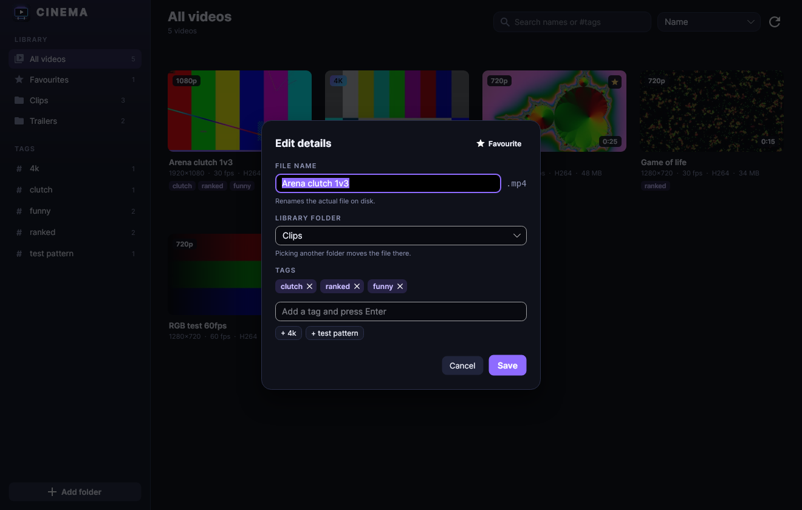
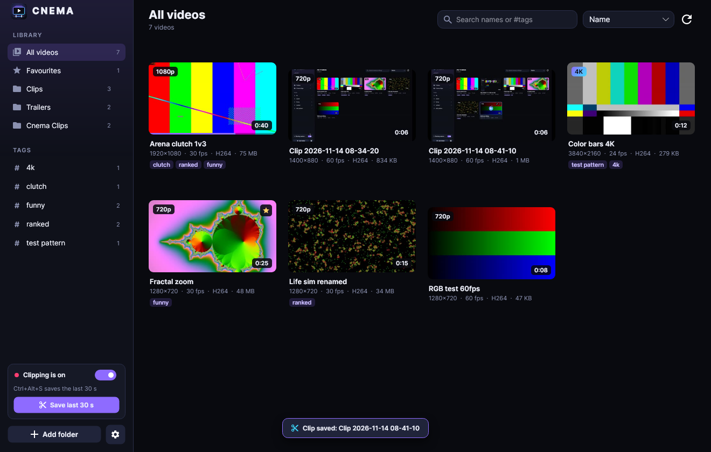
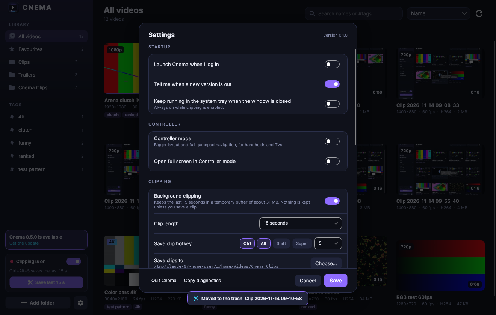
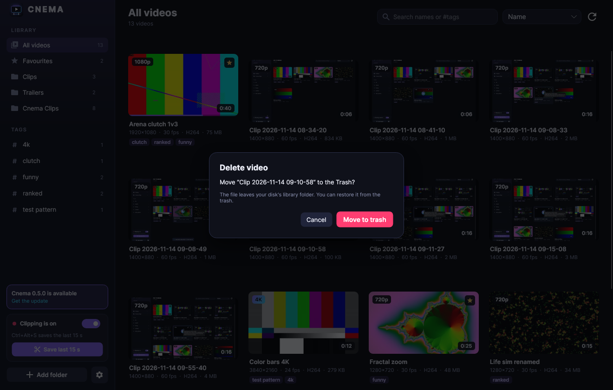
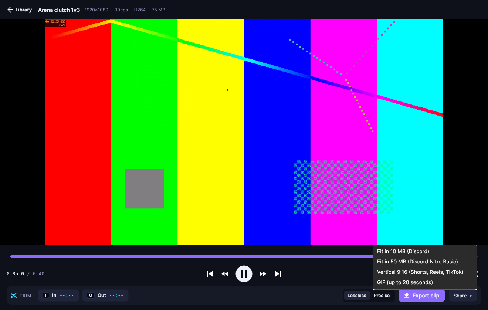
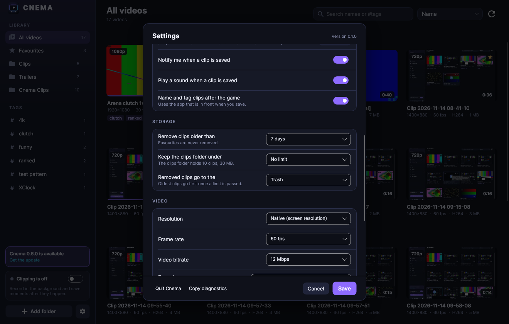
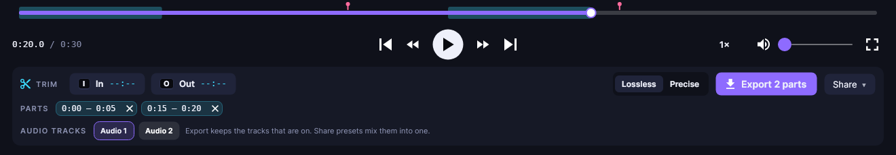
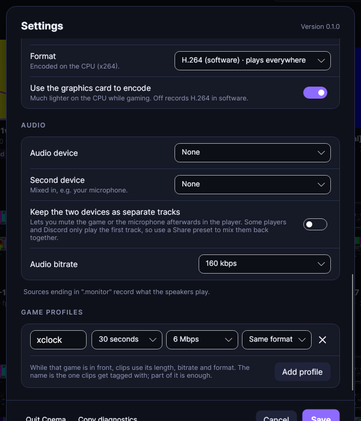
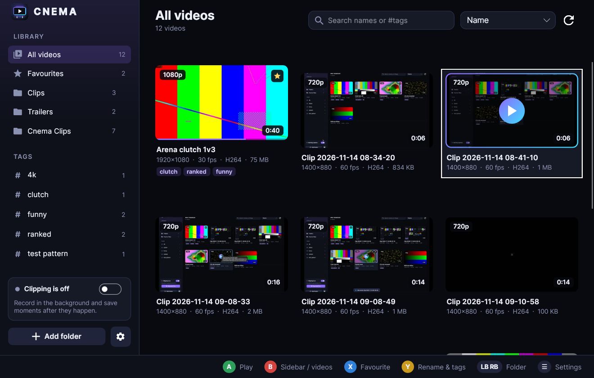

# Cnema

A video library and player built on libVLC. Point it at folders, it scans them for videos, and you can
play anything VLC can play and cut clips out of it without leaving the app.












Stack: C# / .NET 8, [Avalonia 11](https://avaloniaui.net) for UI, [LibVLCSharp](https://code.videolan.org/videolan/LibVLCSharp)
for playback, ffmpeg for thumbnails, metadata and clip export. One codebase for macOS, Windows and Linux.

## Download

Grab a build from [Releases](https://github.com/TheRoben-Dev/Cnema-releases/releases). On macOS and Windows everything is
inside the app: the .NET runtime, libVLC with its plugins, and ffmpeg. Nothing else to install.

On Linux, ffmpeg and .NET are bundled but libVLC comes from your distro (VideoLAN publishes no Linux package):
`sudo apt install libvlc5 vlc-plugin-base`.

The macOS app is not notarized, so the first launch needs either right-click → Open, or:

```sh
xattr -dr com.apple.quarantine /Applications/Cnema.app
```

## Run from source (macOS)

```sh
brew install --cask dotnet-sdk         # .NET 8+ SDK
brew install ffmpeg                    # only needed when running from source
dotnet run --project src/Cnema
```

libVLC is restored from NuGet, so VLC does not need to be installed.

Build a real `Cnema.app` with the icon: `scripts/bundle-macos.sh` (output in `dist/`).

Releases are built by GitHub Actions: run the **Release** workflow with a version number (or push a tag like
`v0.2.0`) to publish macOS (Apple Silicon and Intel), Windows and Linux builds.

| OS | libVLC comes from | Notes |
| --- | --- | --- |
| macOS | `VideoLAN.LibVLC.Mac` NuGet, copied into the app (`libvlc/osx-<arch>/`) | Falls back to an installed VLC.app if the bundled copy is missing. |
| Windows | `VideoLAN.LibVLC.Windows` NuGet, copied into the app (`libvlc/win-x64/`) | |
| Linux | system packages: `sudo apt install libvlc5 vlc-plugin-base` | |

Set `CNEMA_LIBVLC_PATH` to a folder containing libvlc + libvlccore to override.

## Features

- **Library**: add any number of folders; scanned recursively, watched for changes, cached so launch is instant.
  Thumbnails, duration, resolution, codec, size. Search, sort, per-folder filtering, resume position.
- **Organise**: tag videos and star favourites; both appear in the sidebar and in search (`#tag` searches tags only).
  Rename files and move them between library folders from the app. Tags are stored in Cnema's library, not in
  the files, and follow a file that is renamed or moved outside the app.
- **Multi-part export**: mark a selection, press **A** (*Add part*), mark the next one, and Export joins all parts
  in time order into one file. Lossless parts each start on a keyframe, as with a single trim.
- **Audio tracks**: a video with several audio tracks (see *separate tracks* under clipping) gets a toggle per
  track. Export keeps the tracks that are on; Share presets mix them into one. Playback uses the first one on.
- **Markers**: loud moments in the audio are found when a video opens and shown as pink ticks on the timeline;
  session bookmarks are amber. **N** and **Shift+N** jump between them.
- **Hover scrub**: move the pointer across a card to flick through ten frames of the video. The filmstrip is
  made the first time you hover and cached next to the thumbnail.
- **Share presets** (player, *Share*): fit the selection in 10 MB or 50 MB for Discord (two-pass H.264, resolution
  and frame rate drop only as far as the size needs), centre-cropped vertical 9:16, or a GIF of up to 20 seconds.
  With no in/out points set, the whole video is converted. The result lands next to the source.
- **Delete**: right-click a video, press Delete on a focused card, or use the Edit panel. Files go to the system
  trash (Finder Trash, Recycle Bin, XDG trash), never straight off the disk.
- **Player**: libVLC playback, frame stepping, speed, volume, fullscreen.
- **Trim**: set in/out at the playhead or drag the brackets on the timeline, preview/loop the selection, export.
  - *Lossless* (default): stream copy. Instant, zero quality loss, keeps the container. The cut starts on the
    keyframe at or before the in point, so the clip can start up to a GOP earlier than marked.
  - *Precise*: re-encodes to H.264/AAC MP4 (CRF 18). Frame-accurate, slower, slight generation loss.

### Background clipping

Turn on **Clipping** in the sidebar (or in Settings) and Cnema keeps recording the screen into a small
rolling buffer. Press the hotkey (default `Ctrl+Alt+S`, `⌃⌥S` on macOS) and the last 30 seconds are
written to your clips folder, which is a library folder, so the clip shows up in the app straight away.

- **Runs in the background.** Closing the window leaves Cnema in the menu bar / system tray. Settings has
  "Launch Cnema when I log in"; it then starts without a window.
- **Light on resources.** One ffmpeg process encodes with the GPU where it can (VideoToolbox on macOS;
  NVENC, AMF or Quick Sync on Windows) and falls back to x264. The buffer is 2-second segments in the temp
  folder, capped at the clip length; saving is a stream copy, not a re-encode.
- **Settings:** clip length (15 s to 5 min), resolution, frame rate, video bitrate, hardware encoding,
  two audio devices (mixed), audio bitrate, hotkey, clips folder.

Platform notes:

| | Screen | Audio |
|---|---|---|
| macOS | Needs the Screen Recording permission (asked on first use). | "System audio" (macOS 13+, via ScreenCaptureKit) records everything you hear; microphones work as they are. |
| Windows | Desktop Duplication (`ddagrab`), `gdigrab` as fallback. | DirectShow devices. System sound needs "Stereo Mix" or a loopback device. |
| Linux | X11 sessions only (`x11grab`); Wayland is not supported yet. | PulseAudio / PipeWire sources; `.monitor` sources record system sound. |

### Session recording, separate tracks and game profiles

- **Record session** (sidebar or tray, while clipping is on) keeps everything from that moment until you stop
  and saves it as one video. During a session the clip hotkey adds a **bookmark** instead of cutting a clip.
  It is the same capture as the replay buffer, so there is no second encoder; the session is held in the
  temporary buffer until it is saved, which needs that much free space. Quitting or a capture restart saves
  the session first.
- **Separate tracks** (Settings, Audio): with two audio devices, record them as two tracks instead of one mix,
  so the game or the microphone can be left out afterwards.
- **Game profiles** (Settings): per game, a different clip length, bitrate or format. Cnema checks which app is
  in front every few seconds while profiles exist. Changing bitrate or format restarts the capture, so the
  profile stays on while you alt-tab and is only dropped after two minutes away from the game.

### Storage limits

Settings, Storage can keep the clips folder in check: remove clips older than a number of days, and keep the
folder under a size cap by removing the oldest clips first. Removed clips go to the trash or to an archive
folder of your choice. Favourites are never removed, other library folders are never touched, and both limits
are off by default. The check runs at launch, after each saved clip and when settings change.

### Updates and diagnostics

Cnema checks the public releases page at launch and every 3 hours. At launch a newer version is installed
straight away: Cnema downloads the build for your system, checks its size and SHA-256 against what GitHub
published, swaps the app once it has quit and starts again. The old app is kept until the new one is in place.
A session recording in progress is never interrupted, and each version is tried once, so a failed install
leaves you with the "new version" card (click it to install) instead of a restart loop. After an update a
"What's new" screen lists the changes since the version you had; **Settings, What's new** opens the whole
list, which lives in [CHANGELOG.md](CHANGELOG.md). Both the check and the automatic install can be turned
off in Settings.

On macOS the builds are not signed with a Developer ID, so the system may ask for the Screen Recording
permission again after an update.

Warnings, capture errors and crashes are written to `logs/cnema.log` in Cnema's data folder (rotated at 512 KB).
**Settings, Copy diagnostics** puts the version, OS, encoder list, capture setup and the end of the log on the
clipboard, ready to paste into a bug report.

Saved clips are named and tagged after the app that was in front when the hotkey was pressed (for example
`Warframe 2026-11-14 21-03-10.mp4`, tagged `warframe`), and Cnema plays a short sound on save. Both can be
turned off in Settings.

### Controller mode

Settings › Controller › **Controller mode** turns the same app into a couch / handheld layout: everything
is scaled up, a button legend runs along the bottom, and an Xbox controller (or any pad SDL knows: PlayStation,
Switch Pro, Steam Deck…) drives it. It can open full screen automatically.

| | Library | Player |
|---|---|---|
| D-pad / left stick | Move between cards, sidebar and sort | Seek ±5 s (◀ ▶), volume (▲ ▼) |
| A | Play / select | Play / pause |
| B | Jump between sidebar and videos | Back to library |
| X / Y | Favourite / rename & tag | Mark in / mark out |
| LB / RB | Previous / next folder or tag | Step one frame |
| LT / RT | | Seek ±10 s |
| Menu ☰ | Settings | Export clip |
| View ⧉ | Save clip | Save clip |

Arrow keys, Enter and Esc work the same way, so a TV remote or keyboard is fine too.

### Clip formats

Settings › Video › **Format** lists only what this computer can encode in hardware: H.264 everywhere, HEVC
on Macs and recent GPUs, AV1 on NVIDIA RTX 40+, AMD RDNA3+ and Intel Arc. HEVC is about half the size of
H.264 at the same quality. Turning off "Use the graphics card" records H.264 with x264.

### Shortcuts (player)

| Key | Action | Key | Action |
| --- | --- | --- | --- |
| Space / K | Play / pause | I / O | Set in / out |
| ← / → | Seek 5 s (Shift: 1 s) | Shift+I / Shift+O | Jump to in / out |
| J | Back 10 s | P | Play selection |
| , / . | Previous / next frame | L | Loop selection |
| ↑ / ↓ | Volume | X | Clear selection |
| M | Mute | E | Export clip |
| F | Fullscreen | Esc | Back to library |
| A | Add selection as a part | N / Shift+N | Next / previous marker |

## Layout

```
src/Cnema
  Services/    VlcBootstrap (native lib loading per OS), LibraryService (scan/cache/watch),
               MediaProbe, ThumbnailService, TrimService, ToolLocator, PlatformShell, AppPaths
  Controls/    VideoFrameBuffer + VideoSurface (libVLC -> bitmap), TrimTimeline (scrubber with in/out)
  ViewModels/  MainViewModel (library), PlayerViewModel (transport + trimming)
  Views/       MainWindow
```

Data lives in `~/Library/Application Support/Cnema` (macOS), `%LOCALAPPDATA%\Cnema` (Windows),
`~/.local/share/Cnema` (Linux).

## Design notes

- **Not a fork of VLC's source.** VLC itself is ~1M lines of C/C++/Obj-C with a separate UI per platform;
  libVLC is the same engine exposed as a library, so playback is identical while the UI is ours.
- **Video is rendered through libVLC's frame callbacks** into an Avalonia bitmap rather than handing VLC a
  native window. It behaves the same on every OS and lets UI sit on top of the video. The cost is one CPU copy
  per frame (and no zero-copy GPU path); fine through 4K, worth revisiting for 8K/high-fps HDR.
- **All OS-specific code is in four places**: `VlcBootstrap`, `AppPaths`, `PlatformShell`, `ToolLocator`,
  plus title-bar insets in `MainWindow.axaml.cs`.

## Licensing

Cnema is MIT licensed. Release builds bundle libVLC (LGPL, dynamically linked) and ffmpeg (GPL, run as a
separate program); see [THIRD-PARTY-NOTICES.md](THIRD-PARTY-NOTICES.md).
